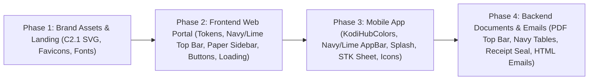

# KodiHub "Ledger Roof, Refined" (C2.1) — Monorepo Brand & Theme Implementation Plan

**Date:** 2026-10-31
**Source Specification:** `/Users/kelvinmbugua/Downloads/KodiHub/Ledger roof, refined · brand and theme guidelines-html/Logo-C2.dc.html` (`01 · Logo` through `08 · Loading`)
**Scope:** `frontend/` (Web App), `mobile/` (Flutter Android & iOS), `backend/` (PDF Documents & HTML Emails), `landing/` (Public Marketing Site)
**Status:** PLANNED

---

## 1. Executive Summary & Gap Audit

The **"Ledger roof, refined" (`C2.1 · Original`)** brand and theme guideline defines a unified visual identity and design system across every KodiHub surface:
- **Brand Mark (`C2.1`)**: A roof chevron over three left-aligned ledger bars (two in navy/white representing rent & utility lines, and a shorter third bar always in `#84BD00` lime representing the cleared balance).
- **Wordmark**: Lowercase **`kodihub`** set in `Lufga` SemiBold (`600`), `letter-spacing: -0.04em`, split into **`kodi`** (`#002B4D` on light / `#FFFFFF` on navy) + **`hub`** (`#4D6B10` on light / `#84BD00` on navy).
- **Colour Discipline**: *"Lime speaks, blue informs. Navy carries the weight."* `#002B4D` navy anchors navigation bars, primary buttons, and document headers; `#84BD00` lime is reserved for the 3rd ledger bar, the `3px` bottom stripe on navy app bars, collection progress bars, and money-moving CTAs (`Pay now`, `Send STK`, `Remit`); `#FAFAF7` warm paper is the canvas; `#FFFFFF` is used for cards, inputs, and PDFs.

### Current-State vs. Target Gap Matrix

| Component | Current State | Target (`C2.1` Brand & Theme Guidelines) | Effort |
|---|---|---|---|
| **`frontend/`** | Ported from `pos-react`: dark navy sidebar (`252px`) + white top bar (`64px`); old house outline in `public/favicon.svg`; `.nx-btn--primary` uses olive `--accent` for all actions; plain `"Loading…"` strings; no top route bar or warm skeleton shimmer; `OwnerPortal` & `TenantPortal` use white header without navy/lime bar. | **Top bar** in `#002B4D` navy (`56px`) with `3px solid #84BD00` bottom stripe, reversed `C2.1` mark + `kodihub` wordmark, org switcher pill, `Search ⌘K`, and `#84BD00` avatar. **Staff sidebar** (`220px`) on `#FAFAF7` paper with `#EEF6DB` active fill + `3px #4D6B10` left inset bar. **Buttons**: `#002B4D` primary pill (`999px`) vs `#84BD00` money CTA pill. **Tenant portal**: `640px` single-column mobile mirror with `#002B4D` balance hero card + `#84BD00` `"Pay now"` pill. **6 loading patterns** (animated `C2.1` splash, inline spinner, warm `#ECE9E0` skeletons, determinate progress bar, `300ms` top route bar, `60s` M-Pesa STK timer + fallback). | **High (Major)** |
| **`mobile/`** | Still named `Hodi` in `app.dart`, `pubspec.yaml`, `auth_scaffold.dart`, `tenant_shell.dart`; `HodiColors` in `lib/core/theme.dart` uses sky-blue (`0xFF60A5FA`) for `lime` and cool grey (`0xFFF4F7FC`) for `paper`; white `AppBar` without `3px` lime stripe; default `CircularProgressIndicator` splash; `StkPaySheet` lacks `60s` countdown & Paybill fallback; default Flutter launcher icons. | Rebrand to **`kodihub`**; bundle `Lufga` + `JetBrains Mono` fonts; replace `HodiColors` with canonical `KodiHubColors` (`#002B4D`, `#84BD00`, `#4D6B10`, `#EEF6DB`, `#FAFAF7`, `#0A2540`) + dark mode (`#06121F` bg, `#0C1E33` card, `#84BD00` primary); `#002B4D` navy `AppBar` with `3dp` `#84BD00` bottom stripe & org/unit subtitle; `NavigationBar` with `#EEF6DB` indicator & `#3D5509` active tint; animated `C2.1` splash screen (`< 1.5s`); redesigned `StkPaySheet` with `60s` timer & manual Paybill fallback; `C2.1` iOS & Android adaptive launcher icons. | **High (Major)** |
| **`backend/`** | `src/common/pdf/pdf.ts` uses neutral greyscale (`#111827` top bar, `#F3F4F6` table headers, zebra striping, rectangular tags, no `C2.1` logo in footer, no rotated `PAID` seal on receipts). `email-templates.ts` uses `#1a2e05` dark-green header. | **PDFs**: `5pt` `#002B4D` navy + `2pt` `#84BD00` lime top edge bar; `#002B4D` table headers with white caps; no zebra stripes (hairline dividers only); `#EEF6DB` lime-soft totals row; outlined payment instructions box; Receipt `#002B4D` `"AMOUNT RECEIVED"` banner + rotated `-12deg` lime `"PAID"` seal; `< 8pt` footer with vector `C2.1` mark + `kodihub` + `"Page X of Y"`. **HTML Emails**: `#002B4D` navy header + `3px #84BD00` stripe + `kodihub` wordmark. | **Medium** |
| **`landing/`** | Colors, typography, and layout already match the redesign, but header/footer SVG still uses a temporary house icon and `KodiHub` mixed-case text; no embedded `C2.1` SVG favicon. | Replace header & footer SVG with canonical `C2.1` mark (roof chevron + 3 ledger bars) and lowercase `kodi` + `hub` split-colour wordmark; add embedded `C2.1` SVG favicon in `landing/index.html` and `backend/src/modules/platform/landing-page.ts`. | **Low** |

---

## 2. Canonical Brand & Design Specifications

### 2.1 Logo & Wordmark (`01 · Logo — C2.1 · Original`)

#### Primary Mark SVG (`viewBox="0 0 48 48"`)
- **On Light / Paper (`#FAFAF7` or `#FFFFFF`)**:
  ```xml
  <svg viewBox="0 0 48 48" aria-hidden="true">
    <path d="M6 20 24 6l18 14" fill="none" stroke="#002b4d" stroke-width="4.5" stroke-linecap="round" stroke-linejoin="round"/>
    <rect x="12" y="24" width="24" height="4.4" rx="2.2" fill="#002b4d"/>
    <rect x="12" y="31.5" width="17" height="4.4" rx="2.2" fill="#002b4d"/>
    <rect x="12" y="39" width="10" height="4.4" rx="2.2" fill="#84bd00"/>
  </svg>
  ```
- **On Navy (`#002B4D` or `#06121F`)**:
  - Roof stroke and top two bars change from `#002b4d` to `#ffffff`; 3rd bar remains `#84bd00`.
- **One-Colour Print / Stamps**:
  - Roof stroke and all three bars use `#0a2540`.
- **On Lime (`#84BD00`)**:
  - Roof stroke and top two bars use `#002b4d`; 3rd bar uses `#ffffff`.

#### App Icon & Favicon Variants (`viewBox="0 0 48 48"`)
- **iOS / App Tile (`rx="11"`, `#002B4D` background)**:
  - `<rect width="48" height="48" rx="11" fill="#002b4d"/>`
  - `<path d="M11 21 24 11l13 10" fill="none" stroke="#ffffff" stroke-width="3.6" stroke-linecap="round" stroke-linejoin="round"/>`
  - `<rect x="15" y="24" width="18" height="3.6" rx="1.8" fill="#ffffff"/>`
  - `<rect x="15" y="30" width="13" height="3.6" rx="1.8" fill="#ffffff"/>`
  - `<rect x="15" y="36" width="8" height="3.6" rx="1.8" fill="#84bd00"/>`
- **Android Adaptive Icon (`circle r="24"`, `#002B4D` background)**:
  - `<circle cx="24" cy="24" r="24" fill="#002b4d"/>`
  - `<path d="M12.5 21.5 24 12.5l11.5 9" fill="none" stroke="#ffffff" stroke-width="3.4" stroke-linecap="round" stroke-linejoin="round"/>`
  - `<rect x="16" y="24" width="16" height="3.4" rx="1.7" fill="#ffffff"/>`
  - `<rect x="16" y="29.5" width="11.5" height="3.4" rx="1.7" fill="#ffffff"/>`
  - `<rect x="16" y="35" width="7" height="3.4" rx="1.7" fill="#84bd00"/>`
- **Favicon 32px (`public/favicon.svg`, `rx="10"`)**:
  - `<rect width="48" height="48" rx="10" fill="#002b4d"/>`
  - `<path d="M9 22 24 10l15 12" fill="none" stroke="#ffffff" stroke-width="5" stroke-linecap="round" stroke-linejoin="round"/>`
  - `<rect x="13" y="27" width="22" height="5.5" rx="2.75" fill="#ffffff"/>`
  - `<rect x="13" y="35" width="11" height="5.5" rx="2.75" fill="#84bd00"/>`
- **Favicon 16px (`public/favicon-16.svg`, `rx="9"`)**:
  - `<rect width="48" height="48" rx="9" fill="#002b4d"/>`
  - `<path d="M8 23 24 10l16 13" fill="none" stroke="#ffffff" stroke-width="7" stroke-linecap="round" stroke-linejoin="round"/>`
  - `<rect x="12" y="31" width="14" height="8" rx="4" fill="#84bd00"/>`

#### Wordmark Construction
- Always lowercase **`kodihub`** in `Lufga` SemiBold (`font-weight: 600`), `letter-spacing: -0.04em`, `line-height: 1`:
  - On light/paper: `<span style="color:#002b4d">kodi</span><span style="color:#4d6b10">hub</span>`
  - On navy: `<span style="color:#ffffff">kodi</span><span style="color:#84bd00">hub</span>`
- Minimum sizes: `120px` full lockup, `24px` icon-only (`32px`/`16px` simplified favicons below `24px`).

---

### 2.2 Colour Tokens (`02 · Colour`)

| Role | Token | Light Value | Dark Value | Usage |
|---|---|---|---|---|
| **Primary / Brand Navy** | `--navy` / `--nav-background` | `#002B4D` | `#002B4D` | Top app bar, auth brand panel, PDF header/table bar |
| **Navy Deep** | `--navy-deep` | `#0A1F36` | `#06121F` | Phone bezels, footer depth, dark page background |
| **Primary Action** | `--primary` | `#002B4D` (hover `#0A3A66`) | `#84BD00` (hover `#9DD000`) | Default primary buttons (`Run invoices`, `Save`) |
| **Brand Lime** | `--lime` / `--brand-stripe` | `#84BD00` | `#84BD00` | 3px top-bar stripe, 3rd ledger bar, progress bar fill, money CTAs |
| **Lime Text (AA Safe)** | `--accent` / `--lime-text` | `#4D6B10` (hover `#3D5509`) | `#9DD000` (hover `#B0E500`) | Accent text on light (`5.7:1`), focus ring, active nav edge |
| **Lime Soft** | `--accent-soft` / `--lime-soft` | `#EEF6DB` | `#1C2E14` | Active sidebar fill, quick-action icon tiles, PDF total row |
| **Paper (Canvas)** | `--background` / `--paper` | `#FAFAF7` | `#06121F` | App background, staff sidebar background |
| **Paper 2 (Secondary)** | `--secondary` / `--paper-2` | `#F1EFE9` | `#122438` | Secondary fills, filter bars, table footers |
| **Muted Surface** | `--muted` | `#ECE9E0` | `#16293F` | Progress track, draft/vacant pills, warm skeleton base |
| **Card Surface** | `--card` | `#FFFFFF` | `#0C1E33` | Cards, inputs, sheets, PDF page |
| **Ink (Primary Text)** | `--foreground` / `--text-primary` | `#0A2540` | `#F2F5F9` | Headings, body copy (`15.3:1` on paper) |
| **Ink 2 (Secondary)** | `--text-secondary` | `#1F3A5C` | `#D7E0EC` | Secondary body copy (`11.2:1`) |
| **Muted Text** | `--text-muted` | `#52647E` | `#B7C4D6` | Descriptions (`5.7:1`) |
| **Subtle Text** | `--text-subtle` | `#5B6B82` | `#9EAEC4` | Meta, captions, timestamps (`5.1:1`) |
| **Hairline Border** | `--border` / `--hairline` | `rgba(10, 37, 64, 0.12)` | `rgba(255, 255, 255, 0.12)` | Card borders, dividers |
| **Soft Hairline** | `--border-soft` | `rgba(10, 37, 64, 0.08)` | `rgba(255, 255, 255, 0.08)` | Table row dividers, sidebar border |
| **Success (Paid)** | `--success` / `--success-soft` | `#1F7A4F` / `#E6F4EC` | `#34D399` / `#0D2A1E` | Paid invoices, matched M-Pesa, active tenancies |
| **Part Paid** | `--part-paid` / `--part-paid-soft` | `#3D5509` / `#EEF6DB` | `#9DD000` / `#1C2E14` | Partially paid invoices |
| **Warning (Due / Overdue)** | `--warning` / `--warning-soft` | `#9A5B00` / `#FDF3E3` | `#FBBF24` / `#332100` | Due / Overdue invoices, notice given, timeouts |
| **Danger (Void / Failed)** | `--destructive` / `--destructive-soft` | `#B91C1C` (`#DC2626` border) / `#FDECEC` | `#EF4444` / `#2A1414` | Voided invoices, reversed payments, failed STK |
| **Info (Review / Notice)** | `--info-text` / `--info-soft` | `#28618F` (`#337ABF` solid) / `rgba(51, 122, 191, 0.12)` | `#8FBCE4` / `rgba(95, 159, 216, 0.15)` | Unmatched M-Pesa review, informational banners |

---

### 2.3 Typography & Formatting Rules (`03 · Type`)

- **Font Stack**:
  - Sans (`--font`): `Lufga, ui-sans-serif, system-ui, -apple-system, 'Segoe UI', sans-serif`
  - Mono (`--font-num`): `'JetBrains Mono', ui-monospace, SFMono-Regular, Menlo, monospace`
- **Scale**:
  - `DISPLAY`: `64px / 600 / -0.035em / 1.04` (Landing page only; inside the web portal and mobile app, titles stop at `30px`).
  - `PAGE TITLE`: `30px / 600 / -0.025em / 1.15` (`#0A2540`).
  - `SECTION`: `18px / 600 / -0.015em / 1.3` (`#0A2540`).
  - `BODY`: `15px / 400 / 1.6` (`#1F3A5C`).
  - `META`: `12px / 400 / 1.4` (`#5B6B82`).
  - `KICKER`: `JetBrains Mono 11px / 600 / +0.16em` uppercase (`#4D6B10` or `#5B6B82`).
- **Number, Money, Reference & Date Rules**:
  - Every shilling amount, unit count, percentage, and date column uses `font-variant-numeric: tabular-nums`.
  - Screen money: `"KES 18,500"` (no `.00` on screen unless cents are non-zero); PDF money: `"KES 18,500.00"` (always 2 decimals, right-aligned).
  - Invoice (`INV-2026-000142`), receipt (`RCT-2026-000198`), and M-Pesa (`SJK4P9X2TQ`) references always render in `JetBrains Mono` (`500`).
  - Dates: `"5 Nov 2026"` in UI (`formatDay`), billing periods as `"Nov 2026"` (`formatPeriod`).
  - Sentence case everywhere (buttons, tabs, table headers, navigation); uppercase is reserved strictly for mono kickers and PDF section/table labels.

---

## 3. Workstream 1 — `frontend/` (Web Portal)

### 3.1 Brand Marks, Favicons & Shared `<BrandMark />` Component
- **Files to Create / Modify**:
  - Create [`frontend/src/components/BrandMark.tsx`](file:///Users/kelvinmbugua/UbuntuBackup/CompanyProjects/CloudvaLabs/CloudvaHomes/frontend/src/components/BrandMark.tsx)
  - Update [`frontend/public/favicon.svg`](file:///Users/kelvinmbugua/UbuntuBackup/CompanyProjects/CloudvaLabs/CloudvaHomes/frontend/public/favicon.svg)
  - Create [`frontend/public/favicon-16.svg`](file:///Users/kelvinmbugua/UbuntuBackup/CompanyProjects/CloudvaLabs/CloudvaHomes/frontend/public/favicon-16.svg)
  - Update [`frontend/index.html`](file:///Users/kelvinmbugua/UbuntuBackup/CompanyProjects/CloudvaLabs/CloudvaHomes/frontend/index.html)
- **Implementation Details**:
  1. Replace [`frontend/public/favicon.svg`](file:///Users/kelvinmbugua/UbuntuBackup/CompanyProjects/CloudvaLabs/CloudvaHomes/frontend/public/favicon.svg) with the `C2.1` 32px Favicon SVG (`#002B4D` rounded rect `rx="10"`, white roof chevron, 1 white bar, 1 `#84BD00` lime bar) and add `favicon-16.svg` (`sizes="16x16"`).
  2. In [`frontend/index.html`](file:///Users/kelvinmbugua/UbuntuBackup/CompanyProjects/CloudvaLabs/CloudvaHomes/frontend/index.html), add Google Fonts preconnect + stylesheet for `JetBrains Mono:wght@500;600` so monospace references (`INV-…`, `RCT-…`, M-Pesa codes) and kickers render in true `JetBrains Mono`.
  3. Build `BrandMark.tsx` exporting:
     - `<BrandIcon tone="light" | "navy" | "ink" | "lime" size={28} animated={false} />` — renders the exact `C2.1` `48×48` SVG (roof chevron + 3 left-aligned ledger bars; when `animated={true}`, applies `.kh-bar-1`, `.kh-bar-2`, `.kh-bar-3` sequential animation).
     - `<BrandWordmark tone="light" | "navy" | "ink" | "lime" size={19} />` — renders lowercase `kodi` + `hub` with `Lufga` `600` and `-0.04em` tracking.
     - `<BrandLockup tone="light" | "navy" size="sm" | "md" | "lg" />` — combines `<BrandIcon />` + `<BrandWordmark />`.

### 3.2 Design Tokens & Typography (`tokens.css` & `fonts.css`)
- **Files to Modify**:
  - [`frontend/src/styles/tokens.css`](file:///Users/kelvinmbugua/UbuntuBackup/CompanyProjects/CloudvaLabs/CloudvaHomes/frontend/src/styles/tokens.css)
- **Implementation Details**:
  1. Add canonical `C2.1` tokens in `:root`:
     - `--navy: #002b4d; --navy-deep: #0a1f36; --lime: #84bd00; --lime-text: #4d6b10; --lime-hover: #3d5509; --lime-soft: #eef6db;`
     - `--paper: #fafaf7; --paper-2: #f1efe9; --border-soft: rgba(10, 37, 64, 0.08);`
     - `--part-paid: #3d5509; --part-paid-soft: #eef6db;`
     - `--destructive-text: #b91c1c;`
     - `--radius-input: 10px; --radius-dialog: 12px; --radius-card: 16px; --radius-sheet: 24px; --radius-pill: 999px;`
     - Elevation (strictly two levels per §04):
       - `--shadow-sm: 0 1px 3px rgba(10, 37, 64, 0.06);` (resting card)
       - `--shadow-lg: 0 20px 60px -24px rgba(10, 37, 64, 0.3);` (raised / menus / modals)
  2. In dark mode (`@media (prefers-color-scheme: dark)` and `:root[data-theme='dark']`), keep `--nav-background: #002b4d;` so the top bar and auth brand panel stay `#002B4D` navy in both themes, while `--background: #06121f`, `--card: #0c1e33`, `--secondary: #122438`, and `--primary: #84bd00`.

### 3.3 Web Portal Shells (`05 · Web Portal`)

#### A. Shared Top Navy Bar (`56px` height + `3px solid #84BD00` bottom stripe)
- **Files to Modify**:
  - [`frontend/src/app/AppShell.tsx`](file:///Users/kelvinmbugua/UbuntuBackup/CompanyProjects/CloudvaLabs/CloudvaHomes/frontend/src/app/AppShell.tsx)
  - [`frontend/src/features/admin/AdminShell.tsx`](file:///Users/kelvinmbugua/UbuntuBackup/CompanyProjects/CloudvaLabs/CloudvaHomes/frontend/src/features/admin/AdminShell.tsx) (or wherever `/admin` shell is rendered)
  - [`frontend/src/app/PortalShell.tsx`](file:///Users/kelvinmbugua/UbuntuBackup/CompanyProjects/CloudvaLabs/CloudvaHomes/frontend/src/app/PortalShell.tsx)
  - [`frontend/src/styles/sidebar.css`](file:///Users/kelvinmbugua/UbuntuBackup/CompanyProjects/CloudvaLabs/CloudvaHomes/frontend/src/styles/sidebar.css)
  - [`frontend/src/styles/shell.css`](file:///Users/kelvinmbugua/UbuntuBackup/CompanyProjects/CloudvaLabs/CloudvaHomes/frontend/src/styles/shell.css)
- **Implementation Details**:
  1. Restyle `.ms__top` (Staff/Admin top bar) and `.ow__top` (Owner/Tenant top bar) to match §05:
     - Height: `56px`
     - Background: `#002B4D` (`var(--nav-background)`)
     - Bottom border: `3px solid #84BD00` (`var(--lime)`)
     - Left cluster: Reversed `<BrandLockup tone="navy" size="sm" />` (`C2.1` white/lime icon + `kodi` white / `hub` lime wordmark) + Organisation switcher pill (`padding: 4px 10px; border-radius: 999px; background: rgba(255,255,255,0.1); border: 1px solid rgba(255,255,255,0.2); color: #ffffff; font-size: 12px`).
     - Right cluster: `Search ⌘K` translucent navy pill (`rgba(255,255,255,0.08)` bg, `#d7e0ec` text), Notification bell & Theme toggle styled for navy surface (`color: #d7e0ec`), and `.sh__avatar` in `#84BD00` lime with `#002B4D` bold initials (`width: 30px; height: 30px; background: #84bd00; color: #002b4d; font-weight: 700`).

#### B. Staff & Admin Left Sidebar (`220px` on `#FAFAF7` Paper)
- **Files to Modify**:
  - [`frontend/src/app/Sidebar.tsx`](file:///Users/kelvinmbugua/UbuntuBackup/CompanyProjects/CloudvaLabs/CloudvaHomes/frontend/src/app/Sidebar.tsx)
  - [`frontend/src/styles/sidebar.css`](file:///Users/kelvinmbugua/UbuntuBackup/CompanyProjects/CloudvaLabs/CloudvaHomes/frontend/src/styles/sidebar.css)
- **Implementation Details**:
  1. Per §05 (*"Staff portal: Top bar in `#002B4D` navy with `3px` `#84BD00` bottom border; left sidebar `220px` on `#FAFAF7` paper; active item uses `#EEF6DB` fill, `#3D5509` text and a `3px` `#4D6B10` left bar"*):
     - Change `.sb` width to `220px` (collapsed `64px`), background to `var(--background)` (`#FAFAF7` in light, `#06121F` in dark), right border `1px solid var(--border-soft)`.
     - Default `.sb__item` and `.sb__child`: `color: var(--text-secondary)` (`#1F3A5C`), `border-radius: 10px`, `font-size: 13.5px`.
     - Hover `.sb__item:hover`: `background: var(--secondary)` (`#F1EFE9`), `color: var(--foreground)`.
     - Active `.sb__item.is-active`, `.sb__child.is-active`:
       ```css
       background: var(--accent-soft); /* #eef6db */
       color: var(--accent-hover);     /* #3d5509 */
       font-weight: 600;
       box-shadow: inset 3px 0 0 var(--accent); /* #4d6b10 */
       ```
     - Alert count badge `.sb__count--alert` (e.g., unmatched M-Pesa count): `#FDF3E3` background with `#9A5B00` text (or `--warning-soft` / `--warning`) per the `Unmatched (2)` sidebar specimen in §05.

#### C. Owner Portal Shell (`/owner`)
- **Files to Modify**:
  - [`frontend/src/app/PortalShell.tsx`](file:///Users/kelvinmbugua/UbuntuBackup/CompanyProjects/CloudvaLabs/CloudvaHomes/frontend/src/app/PortalShell.tsx)
  - [`frontend/src/features/owner/OwnerPortal.tsx`](file:///Users/kelvinmbugua/UbuntuBackup/CompanyProjects/CloudvaLabs/CloudvaHomes/frontend/src/features/owner/OwnerPortal.tsx)
  - [`frontend/src/styles/agency.css`](file:///Users/kelvinmbugua/UbuntuBackup/CompanyProjects/CloudvaLabs/CloudvaHomes/frontend/src/styles/agency.css)
- **Implementation Details**:
  1. Top bar uses `#002B4D` navy + `3px solid #84BD00` bottom border, `<BrandLockup tone="navy" />`, and landlord/agency switcher pill.
  2. Horizontal tabs (`Overview`, `Statements`, `Remittances` — rename tab label from `Payouts` or support `Remittances` per §05) sit cleanly on `#FFFFFF` with a `2px solid #4D6B10` active bottom indicator.
  3. Read-only discipline: no primary buttons except `"Download statement"`.

#### D. Tenant Portal Shell (`/tenant` — Single Column `640px` Mobile Mirror)
- **Files to Modify**:
  - [`frontend/src/features/tenant/TenantPortal.tsx`](file:///Users/kelvinmbugua/UbuntuBackup/CompanyProjects/CloudvaLabs/CloudvaHomes/frontend/src/features/tenant/TenantPortal.tsx)
  - [`frontend/src/styles/tenant.css`](file:///Users/kelvinmbugua/UbuntuBackup/CompanyProjects/CloudvaLabs/CloudvaHomes/frontend/src/styles/tenant.css)
- **Implementation Details**:
  1. Constrain `.ow--tenant .ow__page` to `max-width: 640px`.
  2. Header leads with the managing organisation's name (`account.organization.name`), while the footer displays `"Powered by kodihub"` with `<BrandLockup />`.
  3. **Navy Balance Card (`.tp__due`)**:
     - Background `#002B4D` (`var(--nav-background)`), `#FFFFFF` text, `20px` border radius, `20px` padding.
     - Kicker label (`YOU OWE` / `BALANCE DUE`) in `#9EAEC4`, tabular amount in `30px` `#FFFFFF` SemiBold, due/overdue note in `#D7E0EC` (or `#FBBF24` when overdue).
     - **Money CTA (`"Pay now"`)**: Pill button (`border-radius: 999px`) in `#84BD00` lime background with `#002B4D` bold text (`className="nx-btn nx-btn--money nx-btn--lg tp__paybtn"`). Per §05, `"Pay now"` is the only filled primary button on the tenant home screen.

### 3.4 Auth & Public Screens (`BrandPanel.tsx` & `auth.css`)
- **Files to Modify**:
  - [`frontend/src/features/auth/BrandPanel.tsx`](file:///Users/kelvinmbugua/UbuntuBackup/CompanyProjects/CloudvaLabs/CloudvaHomes/frontend/src/features/auth/BrandPanel.tsx)
  - [`frontend/src/styles/auth.css`](file:///Users/kelvinmbugua/UbuntuBackup/CompanyProjects/CloudvaLabs/CloudvaHomes/frontend/src/styles/auth.css)
- **Implementation Details**:
  1. Replace `` + `KodiHub` in [`BrandPanel.tsx`](file:///Users/kelvinmbugua/UbuntuBackup/CompanyProjects/CloudvaLabs/CloudvaHomes/frontend/src/features/auth/BrandPanel.tsx#L14-L17) with `<BrandLockup tone="navy" size="md" />`.
  2. Update `.au__pitch h1 em` in [`auth.css`](file:///Users/kelvinmbugua/UbuntuBackup/CompanyProjects/CloudvaLabs/CloudvaHomes/frontend/src/styles/auth.css#L69) from `#9dd000` to `#84bd00` and `.au__submit` to a pill button (`border-radius: 999px`, `#002B4D` primary in light mode / `#84BD00` in dark mode).

### 3.5 Components: Buttons, Inputs, Status Badges & Hairline Tables (`04 · Components`)
- **Files to Modify**:
  - [`frontend/src/styles/form.css`](file:///Users/kelvinmbugua/UbuntuBackup/CompanyProjects/CloudvaLabs/CloudvaHomes/frontend/src/styles/form.css)
  - [`frontend/src/styles/admin.css`](file:///Users/kelvinmbugua/UbuntuBackup/CompanyProjects/CloudvaLabs/CloudvaHomes/frontend/src/styles/admin.css)
  - [`frontend/src/components/ConfirmDelete.tsx`](file:///Users/kelvinmbugua/UbuntuBackup/CompanyProjects/CloudvaLabs/CloudvaHomes/frontend/src/components/ConfirmDelete.tsx)
  - [`frontend/src/features/payments/RecordPaymentSheet.tsx`](file:///Users/kelvinmbugua/UbuntuBackup/CompanyProjects/CloudvaLabs/CloudvaHomes/frontend/src/features/payments/RecordPaymentSheet.tsx)
  - [`frontend/src/features/tenant/PaySheet.tsx`](file:///Users/kelvinmbugua/UbuntuBackup/CompanyProjects/CloudvaLabs/CloudvaHomes/frontend/src/features/tenant/PaySheet.tsx)
- **Implementation Details**:
  1. **Buttons (`.nx-btn`, `.sh__cta`)**:
     - `border-radius: var(--radius-pill)` (`999px`), `min-height: 44px` (`36px` for `.nx-btn--sm`), `font-weight: 600`, sentence case.
     - `.nx-btn--primary` & `.sh__cta`: `background: var(--primary)` (`#002B4D` in light, `#84BD00` in dark), `color: var(--primary-foreground)` (`#FFFFFF` in light, `#002B4D` in dark).
     - **New `.nx-btn--money`**: `background: #84bd00; border-color: #84bd00; color: #002b4d; font-weight: 600;` (hover `#9dd000`). Used exclusively on money-moving actions (`"Pay now"`, `"Send STK"`, `"Remit"`, `"Pay KES …"`).
     - `.nx-btn` (Secondary / Outline): `background: var(--card); color: var(--primary); border: 1px solid rgba(10, 37, 64, 0.18)`.
     - `.nx-btn--ghost`: `background: transparent; border-color: transparent; color: var(--primary)`.
     - `.nx-btn--danger`: Outlined by default (`background: var(--card); color: #b91c1c; border: 1px solid rgba(220, 38, 38, 0.4)`); add `.nx-btn--danger-solid` (`background: #dc2626; color: #ffffff`) used only on the final confirm button inside [`ConfirmDelete.tsx`](file:///Users/kelvinmbugua/UbuntuBackup/CompanyProjects/CloudvaLabs/CloudvaHomes/frontend/src/components/ConfirmDelete.tsx).
  2. **Inputs (`.fld > input`, `.fld > select`, `.au__input`)**:
     - `border-radius: 10px`, `border: 1px solid var(--input)` (`rgba(10, 37, 64, 0.18)`).
     - Focus state: `border-color: #4d6b10; box-shadow: 0 0 0 3px rgba(77, 107, 16, 0.25)` (in dark mode: `#84bd00` + `rgba(132, 189, 0, 0.25)`).
     - Error state (`.fld.is-bad`): `border-color: #dc2626`, `.fld__err` in `12px #b91c1c`.
  3. **Status Pills (`.ad__badge`)**:
     - Update `.ad__badge` in [`admin.css`](file:///Users/kelvinmbugua/UbuntuBackup/CompanyProjects/CloudvaLabs/CloudvaHomes/frontend/src/styles/admin.css) to exact `C2.1` pairings (`padding: 3px 10px; border-radius: 999px; font-size: 12px; font-weight: 600`):
       - `Paid` / `Matched` / `Occupied` (`.ad__badge--ok`): `#E6F4EC` bg, `#1F7A4F` text.
       - `Part paid` (`.ad__badge--part`): `#EEF6DB` bg, `#3D5509` text.
       - `Due` / `Overdue` / `On notice` (`.ad__badge--warn`): `#FDF3E3` bg, `#9A5B00` text.
       - `Void` / `Failed` / `Reversed` (`.ad__badge--bad`): `#FDECEC` bg, `#B91C1C` text.
       - `Review` / `Info` (`.ad__badge--info`): `rgba(51, 122, 191, 0.12)` bg, `#28618F` text.
       - `Draft` / `Vacant` (`.ad__badge--neutral`): `#ECE9E0` bg, `#52647E` text.
  4. **Tables (`.ad__table`)**:
     - Hairline horizontal rows (`1px solid rgba(10, 37, 64, 0.08)`), **never zebra-striped**, money columns right-aligned with `.num` (`font-variant-numeric: tabular-nums`), reference codes (`INV-…`, `RCT-…`, M-Pesa codes) in `var(--font-num)` (`JetBrains Mono`).

### 3.6 Loading & Waiting System (`08 · Loading`)
- **Files to Create / Modify**:
  - Update [`frontend/src/components/Splash.tsx`](file:///Users/kelvinmbugua/UbuntuBackup/CompanyProjects/CloudvaLabs/CloudvaHomes/frontend/src/components/Splash.tsx)
  - Create [`frontend/src/components/Loading.tsx`](file:///Users/kelvinmbugua/UbuntuBackup/CompanyProjects/CloudvaLabs/CloudvaHomes/frontend/src/components/Loading.tsx) (`Spinner`, `TableSkeleton`, `CardSkeleton`, `BatchProgressBar`, `TopRouteProgress`)
  - Create [`frontend/src/styles/loading.css`](file:///Users/kelvinmbugua/UbuntuBackup/CompanyProjects/CloudvaLabs/CloudvaHomes/frontend/src/styles/loading.css)
  - Update [`frontend/src/features/tenant/PaySheet.tsx`](file:///Users/kelvinmbugua/UbuntuBackup/CompanyProjects/CloudvaLabs/CloudvaHomes/frontend/src/features/tenant/PaySheet.tsx) and [`frontend/src/features/mpesa/StkPromptSheet.tsx`](file:///Users/kelvinmbugua/UbuntuBackup/CompanyProjects/CloudvaLabs/CloudvaHomes/frontend/src/features/mpesa/StkPromptSheet.tsx) (or staff STK dialog)
- **Implementation Details**:
  1. **Pattern 1 — Animated `C2.1` Logo Loader (`Splash.tsx`)**:
     - Renders the `C2.1` roof chevron + 3 ledger bars animating `scaleX(0 -> 1)` sequentially (`0s`, `0.18s`, `0.36s` via `@keyframes khBar`) + `kodihub` wordmark + status subtitle (`"Checking your session…"`).
  2. **Pattern 2 — Inline Spinner (`<Spinner />`)**:
     - `18px` / `28px` SVG ring with `#ECE9E0` track and `#4D6B10` spinning arc on light (`#84BD00` on navy; `#002B4D` inside `#84BD00` money buttons).
     - Buttons in busy state lock `disabled={true}` and keep width stable while showing `<Spinner size={14} />` + active verb (`"Sending STK…"`, `"Saving…"`).
  3. **Pattern 3 — Warm Paper Skeleton Shimmer (`<TableSkeleton />`, `<CardSkeleton />`)**:
     - Uses `linear-gradient(90deg, #ece9e0 0%, #f6f4ef 50%, #ece9e0 100%)` (`background-size: 200% 100%`, `animation: khShimmer 1.6s ease-in-out infinite`) matching real row/card geometry instead of `"Loading…"` text inside tables and overview cards.
  4. **Pattern 4 — Determinate Progress Bar (`<BatchProgressBar />`)**:
     - `8px` rounded `#ECE9E0` track with `#84BD00` fill, tabular counter (`38 of 64`), and current item subtitle for CSV imports and batch invoice runs.
  5. **Pattern 5 — Top Bar Route Loader (`<TopRouteProgress />`)**:
     - `3px` indeterminate `#84BD00` bar running along the `#84BD00` stripe at the bottom of `.ms__top` / `.ow__top` whenever an active query/navigation takes longer than `300ms`.
  6. **Pattern 6 — Pending M-Pesa STK Timer & 60s Fallback (`PaySheet.tsx`)**:
     - Displays a pulsing `#84BD00` dot (`box-shadow: 0 0 0 5px #eef6db`), `"WAITING FOR M-PESA"` mono kicker, `"Check your phone"`, and a live elapsed timer (`0:24`).
     - At `60s`, automatically transitions to `"Didn't get the prompt?"` with a `"Send prompt again"` button and manual Paybill + Account fallback instructions.
  7. **Reduced Motion**:
     - Under `@media (prefers-reduced-motion: reduce)`, disable `khSpin`, `khPulse`, `khShimmer`, `khBar`, and `khTopbar`; skeletons become static `#ECE9E0` and the logo loader renders all three bars at full width.

---

## 4. Workstream 2 — `mobile/` (Flutter Android & iOS App)

### 4.1 Rebrand `Hodi` → `kodihub` & Bundle Fonts (`Lufga` + `JetBrains Mono`)
- **Files to Modify**:
  - [`mobile/pubspec.yaml`](file:///Users/kelvinmbugua/UbuntuBackup/CompanyProjects/CloudvaLabs/CloudvaHomes/mobile/pubspec.yaml)
  - [`mobile/lib/app.dart`](file:///Users/kelvinmbugua/UbuntuBackup/CompanyProjects/CloudvaLabs/CloudvaHomes/mobile/lib/app.dart)
  - [`mobile/lib/core/router.dart`](file:///Users/kelvinmbugua/UbuntuBackup/CompanyProjects/CloudvaLabs/CloudvaHomes/mobile/lib/core/router.dart)
  - [`mobile/lib/features/auth/auth_scaffold.dart`](file:///Users/kelvinmbugua/UbuntuBackup/CompanyProjects/CloudvaLabs/CloudvaHomes/mobile/lib/features/auth/auth_scaffold.dart)
  - [`mobile/lib/features/tenant/tenant_shell.dart`](file:///Users/kelvinmbugua/UbuntuBackup/CompanyProjects/CloudvaLabs/CloudvaHomes/mobile/lib/features/tenant/tenant_shell.dart)
  - [`mobile/lib/features/owner/owner_screens.dart`](file:///Users/kelvinmbugua/UbuntuBackup/CompanyProjects/CloudvaLabs/CloudvaHomes/mobile/lib/features/owner/owner_screens.dart)
  - [`mobile/lib/features/billing/pay_hodi.dart`](file:///Users/kelvinmbugua/UbuntuBackup/CompanyProjects/CloudvaLabs/CloudvaHomes/mobile/lib/features/billing/pay_hodi.dart) & [`plan_billing_screen.dart`](file:///Users/kelvinmbugua/UbuntuBackup/CompanyProjects/CloudvaLabs/CloudvaHomes/mobile/lib/features/billing/plan_billing_screen.dart)
- **Implementation Details**:
  1. Copy `Lufga` (`Regular`, `Medium`, `SemiBold`, `Bold`) and `JetBrains Mono` (`Medium`, `SemiBold`) font assets into `mobile/assets/fonts/` and register both families in [`mobile/pubspec.yaml`](file:///Users/kelvinmbugua/UbuntuBackup/CompanyProjects/CloudvaLabs/CloudvaHomes/mobile/pubspec.yaml) (`fontFamily: 'Lufga'` as default theme font, `'JetBrainsMono'` for references/kickers).
  2. Update user-facing strings from `'Hodi'` / `'hodi'` to `'KodiHub'` / `'kodihub'` across `app.dart`, `router.dart` (`_Offline`, `_NoAccess`), `auth_scaffold.dart`, `tenant_shell.dart`, `owner_screens.dart`, and `billing/`.

### 4.2 `lib/core/theme.dart` Palette, `ColorScheme` & Component Themes (`06 · Mobile`)
- **Files to Modify**:
  - [`mobile/lib/core/theme.dart`](file:///Users/kelvinmbugua/UbuntuBackup/CompanyProjects/CloudvaLabs/CloudvaHomes/mobile/lib/core/theme.dart)
- **Implementation Details**:
  1. Update `HodiColors` (aliased as `KodiHubColors` for backward compatibility with existing imports) to the exact `C2.1` tokens from §06:
     ```dart
     abstract final class HodiColors {
       static const navy = Color(0xFF002B4D);
       static const navyDeep = Color(0xFF0A1F36);
       static const navyMid = Color(0xFF0A3A66);
       static const lime = Color(0xFF84BD00);
       static const limeText = Color(0xFF4D6B10);
       static const limeHover = Color(0xFF3D5509);
       static const limeSoft = Color(0xFFEEF6DB);
       static const paper = Color(0xFFFAFAF7);
       static const paper2 = Color(0xFFF1EFE9);
       static const muted = Color(0xFFECE9E0);
       static const ink = Color(0xFF0A2540);
       static const inkSecondary = Color(0xFF1F3A5C);
       static const inkMuted = Color(0xFF52647E);
       static const inkSubtle = Color(0xFF5B6B82);
       static const night = Color(0xFF06121F);
       static const nightCard = Color(0xFF0C1E33);
       static const nightRaised = Color(0xFF122438);
       static const success = Color(0xFF1F7A4F);
       static const successSoft = Color(0xFFE6F4EC);
       static const warning = Color(0xFF9A5B00);
       static const warningSoft = Color(0xFFFDF3E3);
       static const danger = Color(0xFFDC2626);
       static const dangerText = Color(0xFFB91C1C);
       static const dangerSoft = Color(0xFFFDECEC);
       static const info = Color(0xFF337ABF);
       static const infoText = Color(0xFF28618F);
       static const infoSoft = Color(0x1F337ABF);
     }
     ```
  2. Configure `ColorScheme` in `hodiTheme(Brightness brightness)`:
     - **Light**: `primary: HodiColors.navy`, `onPrimary: Colors.white`, `secondary: HodiColors.limeText`, `onSecondary: Colors.white`, `tertiary: HodiColors.lime`, `secondaryContainer: HodiColors.limeSoft`, `onSecondaryContainer: HodiColors.limeHover`, `surface: HodiColors.paper`, `surfaceContainerLowest: Colors.white`, `onSurface: HodiColors.ink`, `onSurfaceVariant: HodiColors.inkMuted`, `error: HodiColors.danger`.
     - **Dark**: `primary: HodiColors.lime`, `onPrimary: Color(0xFF001A2E)`, `secondary: Color(0xFF9DD000)`, `secondaryContainer: Color(0xFF1C2E14)`, `onSecondaryContainer: Color(0xFF9DD000)`, `surface: HodiColors.night`, `surfaceContainerLowest: HodiColors.nightCard`, `surfaceContainer: HodiColors.nightRaised`, `onSurface: Color(0xFFF2F5F9)`, `onSurfaceVariant: Color(0xFF9EAEC4)`, `error: Color(0xFFEF4444)`.
  3. **AppBarTheme**:
     - Always `#002B4D` navy background (`HodiColors.navy`) with white foreground (`Colors.white`) in both light and dark modes.
     - Screen title `17sp` SemiBold (`FontWeight.w600`), `#FFFFFF`.
  4. **Buttons & Inputs**:
     - `FilledButtonThemeData`: `StadiumBorder()` (`999px` pill), `minimumSize: Size.fromHeight(48)`, `#002B4D` bg / `#FFFFFF` text in light mode (`#84BD00` bg / `#001A2E` text in dark mode).
     - Add `KodiHubButtonStyles.money()` helper in `theme.dart` returning a `ButtonStyle` with `#84BD00` (`HodiColors.lime`) background and `#002B4D` (`HodiColors.navy`) foreground (`StadiumBorder`, `48dp` height) for `"Pay now"`, `"Send M-Pesa prompt"`, and `"Remit"`.
     - `OutlinedButtonThemeData`: `StadiumBorder()`, `minimumSize: Size(0, 48)`, `side: BorderSide(color: Color(0x2E0A2540))`.
     - `InputDecorationTheme`: `10dp` border radius, `focusedBorder` in `HodiColors.limeText` (`#4D6B10`, `#84BD00` in dark) with `1.5` width.
  5. **NavigationBarThemeData**:
     - `backgroundColor: dark ? HodiColors.nightCard : Colors.white`
     - `indicatorColor: dark ? Color(0xFF1C2E14) : HodiColors.limeSoft` (`#EEF6DB`)
     - `labelBehavior: NavigationDestinationLabelBehavior.alwaysShow`
     - Selected icon & label in `#3D5509` (`HodiColors.limeHover`) in light mode and `#84BD00` (`HodiColors.lime`) in dark mode; unselected in `scheme.onSurfaceVariant` (`#5B6B82`).

### 4.3 Navy AppBar with `3dp` `#84BD00` Bottom Stripe & Two-Line Title
- **Files to Modify**:
  - [`mobile/lib/core/widgets/common.dart`](file:///Users/kelvinmbugua/UbuntuBackup/CompanyProjects/CloudvaLabs/CloudvaHomes/mobile/lib/core/widgets/common.dart)
  - [`mobile/lib/features/staff/staff_widgets.dart`](file:///Users/kelvinmbugua/UbuntuBackup/CompanyProjects/CloudvaLabs/CloudvaHomes/mobile/lib/features/staff/staff_widgets.dart)
  - [`mobile/lib/features/tenant/tenant_shell.dart`](file:///Users/kelvinmbugua/UbuntuBackup/CompanyProjects/CloudvaLabs/CloudvaHomes/mobile/lib/features/tenant/tenant_shell.dart)
  - [`mobile/lib/features/owner/owner_screens.dart`](file:///Users/kelvinmbugua/UbuntuBackup/CompanyProjects/CloudvaLabs/CloudvaHomes/mobile/lib/features/owner/owner_screens.dart)
- **Implementation Details**:
  1. Create a reusable `KodiHubAppBar` (`PreferredSizeWidget`) in [`common.dart`](file:///Users/kelvinmbugua/UbuntuBackup/CompanyProjects/CloudvaLabs/CloudvaHomes/mobile/lib/core/widgets/common.dart) that:
     - Renders on `#002B4D` navy with `foregroundColor: Colors.white`.
     - Displays an optional top subtitle (`subtitle`, e.g., `"Simba Court · Unit B4"` or active organisation name in `11sp` `#9EAEC4`) above the main screen title (`17sp` SemiBold `#FFFFFF`).
     - Draws the signature `3dp` `#84BD00` lime stripe along the bottom edge (and stacks cleanly above any `TabBar` when `bottom` is passed).
  2. Wire `KodiHubAppBar` into `StaffTabScaffold`, `TenantShell`, and `OwnerShell`.

### 4.4 `C2.1` Brand Mark Widget & Animated Splash Screen (`< 1.5s`)
- **Files to Create / Modify**:
  - Create [`mobile/lib/core/widgets/brand_mark.dart`](file:///Users/kelvinmbugua/UbuntuBackup/CompanyProjects/CloudvaLabs/CloudvaHomes/mobile/lib/core/widgets/brand_mark.dart)
  - Update [`mobile/lib/core/router.dart`](file:///Users/kelvinmbugua/UbuntuBackup/CompanyProjects/CloudvaLabs/CloudvaHomes/mobile/lib/core/router.dart) (`_Splash`)
  - Update [`mobile/lib/features/auth/auth_scaffold.dart`](file:///Users/kelvinmbugua/UbuntuBackup/CompanyProjects/CloudvaLabs/CloudvaHomes/mobile/lib/features/auth/auth_scaffold.dart)
- **Implementation Details**:
  1. Build `KodiHubMark` (`CustomPainter` + optional `AnimationController`) and `KodiHubWordmark` (`RichText` with `'kodi'` in white/navy + `'hub'` in `#84BD00`/`#4D6B10`, `fontWeight: FontWeight.w600`, `letterSpacing: -0.9`).
  2. Replace `_Splash` in [`router.dart`](file:///Users/kelvinmbugua/UbuntuBackup/CompanyProjects/CloudvaLabs/CloudvaHomes/mobile/lib/core/router.dart#L87-L92) with the §06 & §08 Splash Screen:
     - Full-screen `#002B4D` navy `Scaffold`.
     - Centered animated `KodiHubMark(size: 56, tone: BrandTone.onNavy, animate: true)` where the 3 ledger bars fill in sequentially (`0ms`, `180ms`, `360ms` intervals, `1400ms` cycle) + `KodiHubWordmark(tone: BrandTone.onNavy, fontSize: 22)`.
     - Respects `MediaQuery.disableAnimationsOf(context)` by rendering all 3 bars at full width when reduced motion is enabled.
  3. Update [`AuthScaffold`](file:///Users/kelvinmbugua/UbuntuBackup/CompanyProjects/CloudvaLabs/CloudvaHomes/mobile/lib/features/auth/auth_scaffold.dart#L78-L98) to replace the old `'hodi'` + sky-blue dot with `KodiHubLockup(tone: BrandTone.onNavy)` and a `3dp` `#84BD00` lime accent bar.

### 4.5 STK Push Waiting Sheet & Bottom Sheets (`stk_sheet.dart`)
- **Files to Modify**:
  - [`mobile/lib/core/widgets/stk_sheet.dart`](file:///Users/kelvinmbugua/UbuntuBackup/CompanyProjects/CloudvaLabs/CloudvaHomes/mobile/lib/core/widgets/stk_sheet.dart)
- **Implementation Details**:
  1. Style the primary submit button in `StkPaySheet` with `KodiHubButtonStyles.money()` (`#84BD00` lime background, `#002B4D` navy text, `999px` pill, `"Send M-Pesa prompt"` / `"Sending STK…"` with inline `#002B4D` spinner).
  2. Redesign `_StatusView` when `status.pending` to match the §06 & §08 STK Push Waiting Sheet:
     - Centered `44×44` circular spinner (`#ECE9E0` background track + `#84BD00` spinning arc).
     - `"WAITING FOR M-PESA"` mono kicker (`11sp` `JetBrainsMono` `#4D6B10`, letter-spacing `1.8`).
     - `"Check your phone"` title (`18sp` SemiBold `#0A2540`).
     - `"Sent to ${status.phone} · ${formatKes(status.amount)}. Enter your M-Pesa PIN."` body (`13sp` `#52647E`) + live elapsed counter (`0:24`).
     - After `60 seconds` (or when timed out), automatically reveal the `"Didn't get the prompt?"` fallback card (`#F1EFE9` surface) with a `"Send prompt again"` button and manual Paybill/Account instructions.

### 4.6 Tenant & Staff Home Screens (`tenant_home_screen.dart` & `home_screen.dart`)
- **Files to Modify**:
  - [`mobile/lib/features/tenant/tenant_home_screen.dart`](file:///Users/kelvinmbugua/UbuntuBackup/CompanyProjects/CloudvaLabs/CloudvaHomes/mobile/lib/features/tenant/tenant_home_screen.dart)
  - [`mobile/lib/features/staff/home/home_screen.dart`](file:///Users/kelvinmbugua/UbuntuBackup/CompanyProjects/CloudvaLabs/CloudvaHomes/mobile/lib/features/staff/home/home_screen.dart)
- **Implementation Details**:
  1. In [`tenant_home_screen.dart`](file:///Users/kelvinmbugua/UbuntuBackup/CompanyProjects/CloudvaLabs/CloudvaHomes/mobile/lib/features/tenant/tenant_home_screen.dart#L218-L231), change the `"Pay now"` button inside `_OwedCard` from white background to `KodiHubButtonStyles.money()` (`#84BD00` lime pill with `#002B4D` text & icon).
  2. In [`home_screen.dart`](file:///Users/kelvinmbugua/UbuntuBackup/CompanyProjects/CloudvaLabs/CloudvaHomes/mobile/lib/features/staff/home/home_screen.dart#L96-L107):
     - Update `_QuickActions` icon circles to use `HodiColors.limeSoft` (`#EEF6DB`) background and `HodiColors.limeHover` (`#3D5509`) icon color in light mode (`#1C2E14` / `#84BD00` in dark mode).
     - Add the `6dp` rounded collection progress bar (`#ECE9E0` track + `#84BD00` fill) inside the `Collected` hero card.
     - Update `_Figure` cards (`Arrears`, `Occupancy`) to use crisp `#FFFFFF` card surfaces with hairline borders and status-colored values (`#9A5B00` warning for arrears, `#1F7A4F` / `#002B4D` for occupancy) instead of pastel full-card tints.

### 4.7 iOS & Android Launcher Icons (`01 · Logo — App Icons`)
- **Files to Modify**:
  - `mobile/ios/Runner/Assets.xcassets/AppIcon.appiconset/*`
  - `mobile/android/app/src/main/res/mipmap-*/ic_launcher.png` (and adaptive icon foreground/background drawables)
- **Implementation Details**:
  1. Render the exact `C2.1` iOS App Icon (`#002B4D` background, white roof chevron `M11 21 24 11l13 10`, two white ledger bars, one `#84BD00` lime bar) to all required iOS PNG sizes (`20pt` through `1024×1024`) and Android `mipmap-mdpi` through `mipmap-xxxhdpi` sizes.

---

## 5. Workstream 3 — `backend/` (PDF Documents & Transactional Emails)

### 5.1 Shared PDF Primitives (`src/common/pdf/pdf.ts`)
- **Files to Modify**:
  - [`backend/src/common/pdf/pdf.ts`](file:///Users/kelvinmbugua/UbuntuBackup/CompanyProjects/CloudvaLabs/CloudvaHomes/backend/src/common/pdf/pdf.ts)
- **Implementation Details**:
  1. **Update `PDF_BRAND` Tokens** to match `07 · Documents`:
     ```ts
     export const PDF_BRAND = {
       brandDark: '#002B4D',      // Navy primary
       brandAccent: '#84BD00',    // Lime accent
       brandText: '#4D6B10',      // Lime text
       brandSoft: '#EEF6DB',      // Lime soft (totals row, highlights)
       brandBorder: '#DCE1E7',
       ink: '#0A2540',            // Primary ink
       inkSecondary: '#1F3A5C',   // Secondary ink
       muted: '#52647E',          // Descriptions
       subtle: '#5B6B82',         // Meta / captions / 7pt labels
       surface: '#FAFAF7',        // Paper
       tableHeaderBg: '#002B4D',  // Navy table header
       tableHeaderFg: '#FFFFFF',  // White table header text
       tableZebraBg: '#FFFFFF',   // No zebra striping per guideline
       border: '#E5E9F0',         // Hairline row divider
       borderStrong: '#CBD5E1',   // Box outline
       ruleHeavy: '#002B4D',      // Navy structural rule
       successText: '#1F7A4F',
       successBg: '#E6F4EC',
       successBorder: '#A7F3D0',
       partPaidText: '#3D5509',
       partPaidBg: '#EEF6DB',
       partPaidBorder: '#C3E088',
       warnText: '#9A5B00',
       warnBg: '#FDF3E3',
       warnBorder: '#FDE68A',
       dangerText: '#B91C1C',
       dangerBg: '#FDECEC',
       dangerBorder: '#FECACA',
       neutralText: '#52647E',
       neutralBg: '#ECE9E0',
       neutralBorder: '#D6D3C9',
     } as const;
     ```
  2. **Top Edge (`drawTopBrandBar`)**:
     - Per §07 (*"5pt `#002B4D` navy band with a 2pt `#84BD00` lime line underneath"*):
       ```ts
       doc.save();
       doc.rect(0, 0, pageWidth, 5).fill('#002B4D');
       doc.rect(0, 5, pageWidth, 2).fill('#84BD00');
       doc.restore();
       ```
  3. **Header (`header`)**:
     - Left column: `"ISSUED BY"` in `7pt` `#5B6B82` caps, Organisation name in `14pt` `Helvetica-Bold` `#0A2540`, address & contacts in `8pt` `#1F3A5C`.
     - Right column: Document title (`INVOICE`, `RECEIPT`, `STATEMENT`, `LEASE AGREEMENT`) in `15pt` `Helvetica-Bold` `#002B4D`, rounded status pill (`roundedRect(..., 7)`), and metadata facts where reference codes (`INV-…`, `RCT-…`, `LSE-…`) use `Courier-Bold` (`8.5pt` `#0A2540`).
     - Support `'partPaid'` tone in `StatusBadgeOptions` (`#3D5509` text on `#EEF6DB` fill).
  4. **Footer (`footer`) with Vector `C2.1` Mark & Page Numbers**:
     - Draw a hairline rule at `doc.page.height - 54`.
     - Left: System notice & reference in `7pt` `#5B6B82` (never larger than `8pt`).
     - Center/Right: Draw the miniature vector `C2.1` mark (roof chevron + 2 `#002B4D` bars + 1 `#84BD00` bar) followed by `"Powered by kodihub"` (`kodi` `#002B4D` + `hub` `#4D6B10`) and `"Page X of Y"` in `7.5pt` `#5B6B82`.

### 5.2 Tenant Invoices & Platform Invoices (`invoice-pdf.ts` & `platform-pdf.ts`)
- **Files to Modify**:
  - [`backend/src/modules/billing/invoices/invoice-pdf.ts`](file:///Users/kelvinmbugua/UbuntuBackup/CompanyProjects/CloudvaLabs/CloudvaHomes/backend/src/modules/billing/invoices/invoice-pdf.ts)
  - [`backend/src/modules/platform/platform-pdf.ts`](file:///Users/kelvinmbugua/UbuntuBackup/CompanyProjects/CloudvaLabs/CloudvaHomes/backend/src/modules/platform/platform-pdf.ts)
- **Implementation Details**:
  1. **Status Pills**:
     - `PAID` → `{ label: 'PAID', tone: 'success' }` (`#1F7A4F` on `#E6F4EC`)
     - `PARTIALLY_PAID` → `{ label: 'PART PAID', tone: 'partPaid' }` (`#3D5509` on `#EEF6DB`)
     - `VOID` → `{ label: 'VOID', tone: 'danger' }` (`#B91C1C` on `#FDECEC`)
     - `UNPAID` / `OVERDUE` → `{ label: i.overdue ? 'OVERDUE' : 'UNPAID · DUE ' + i.dueDate, tone: 'warning' }` (`#9A5B00` on `#FDF3E3`)
  2. **Table Header**:
     - Fill with `#002B4D` (`PDF_BRAND.tableHeaderBg`), text in `#FFFFFF` (`7.5pt` `Helvetica-Bold` uppercase: `DESCRIPTION`, `QTY`, `UNIT PRICE`, `AMOUNT (KES)`).
  3. **Line Rows**:
     - Remove alternating zebra fill; separate rows with crisp `0.5pt` `#E5E9F0` hairline rules.
  4. **Totals & Balance Due Row**:
     - Highlight the final `Total` / `Balance due` bar in `#EEF6DB` (`PDF_BRAND.brandSoft`) with `#002B4D` bold text (`roundedRect` `4pt` radius).
  5. **Outlined Payment Instructions Box**:
     - Render `"HOW TO PAY"` inside a `roundedRect(left, y, width, boxH, 6)` with `1pt` `#CBD5E1` border on `#FFFFFF`, with Paybill and Account numbers in `Courier-Bold` `#0A2540`.

### 5.3 Payment Receipts, Statements & Lease PDF (`payments/pdfs.ts`, `agency/statement-pdf.ts`, `lease-pdf.ts`)
- **Files to Modify**:
  - [`backend/src/modules/payments/pdfs.ts`](file:///Users/kelvinmbugua/UbuntuBackup/CompanyProjects/CloudvaLabs/CloudvaHomes/backend/src/modules/payments/pdfs.ts)
  - [`backend/src/modules/agency/statement-pdf.ts`](file:///Users/kelvinmbugua/UbuntuBackup/CompanyProjects/CloudvaLabs/CloudvaHomes/backend/src/modules/agency/statement-pdf.ts)
  - [`backend/src/modules/portfolio/tenancies/lease-pdf.ts`](file:///Users/kelvinmbugua/UbuntuBackup/CompanyProjects/CloudvaLabs/CloudvaHomes/backend/src/modules/portfolio/tenancies/lease-pdf.ts)
- **Implementation Details**:
  1. **Receipt `#002B4D` Navy `"AMOUNT RECEIVED"` Banner (`renderReceiptPdf`)**:
     - Directly below the header/payer block, draw a rounded `#002B4D` navy banner (`height: 54pt`, `radius: 6pt`; `#B91C1C` when `reversal` is true):
       - Kicker: `"AMOUNT RECEIVED"` in `7pt` `Helvetica-Bold` `#84BD00` (`letter-spacing` style).
       - Value: `"KES 20,650.00"` in `18pt` `Helvetica-Bold` `#FFFFFF`.
       - Subline: `"M-Pesa · Ref SJK4P9X2TQ · From Grace Wanjiku (+254 712 345 678)"` in `8pt` `#D7E0EC`.
  2. **Receipt Rotated `-12deg` Lime `"PAID"` Seal**:
     - For non-reversed receipts, draw a vector double-circle stamp (`outer r=22`, `inner r=18`, `stroke: #4D6B10`, `fill: #EEF6DB` at `35%` opacity, rotated `-12deg`) with a vector checkmark and `"PAID"` in `7pt` `Helvetica-Bold` `#3D5509` beside the `"Balance after payment"` summary.
  3. **Statements & Leases**:
     - Update table headers in `renderStatementPdf`, `renderOwnerStatementPdf`, and `renderLeasePdf` to `#002B4D` navy background with `#FFFFFF` uppercase headers, hairline rows without zebra stripes, and `#EEF6DB` lime-soft highlight on the closing balance row.

### 5.4 Transactional HTML Emails (`src/modules/notifications/email-templates.ts`)
- **Files to Modify**:
  - [`backend/src/modules/notifications/email-templates.ts`](file:///Users/kelvinmbugua/UbuntuBackup/CompanyProjects/CloudvaLabs/CloudvaHomes/backend/src/modules/notifications/email-templates.ts)
- **Implementation Details**:
  1. In [`renderBrandedEmailHtml`](file:///Users/kelvinmbugua/UbuntuBackup/CompanyProjects/CloudvaLabs/CloudvaHomes/backend/src/modules/notifications/email-templates.ts#L744-L812):
     - Change outer canvas background from `#f4f4f0` to `#fafaf7` (`Paper`).
     - Change top header bar from `#1a2e05` to `#002b4d` (`Navy`) with `border-bottom: 3px solid #84bd00` (`Lime`).
     - Render the lowercase `kodi` (`#ffffff`) + `hub` (`#84bd00`) wordmark in the header (plus organisation/brand name if custom).
     - Update section dividers (`--- Section ---`) to `#4d6b10` (`Lime text`) and body copy to `#1f3a5c` / `#0a2540` (`Ink`).

---

## 6. Workstream 4 — `landing/` (Public Marketing Landing Page)

- **Files to Modify**:
  - [`landing/index.html`](file:///Users/kelvinmbugua/UbuntuBackup/CompanyProjects/CloudvaLabs/CloudvaHomes/landing/index.html)
  - [`backend/src/modules/platform/landing-page.ts`](file:///Users/kelvinmbugua/UbuntuBackup/CompanyProjects/CloudvaLabs/CloudvaHomes/backend/src/modules/platform/landing-page.ts)
- **Implementation Details**:
  1. **Embedded `C2.1` SVG Favicon**:
     - Add `<link rel="icon" type="image/svg+xml" href="data:image/svg+xml,..." />` using the `C2.1` 32px Favicon SVG in `<head>`.
  2. **Header Logo Lockup (`#nav-brand`)**:
     - Replace the house-outline `<svg>` at [`landing/index.html#L242-L246`](file:///Users/kelvinmbugua/UbuntuBackup/CompanyProjects/CloudvaLabs/CloudvaHomes/landing/index.html#L242-L246) with the `C2.1` mark (`48×48` viewBox, `#002b4d` roof chevron + 2 `#002b4d` bars + 1 `#84bd00` bar) and lowercase `<span id="nav-brand"><span>kodi</span><span style="color:#4d6b10">hub</span></span>` (`font-weight: 600; letter-spacing: -0.04em`).
  3. **Footer Logo Lockup (`#footer-brand`)**:
     - Replace the footer `<svg>` at [`landing/index.html#L1035-L1039`](file:///Users/kelvinmbugua/UbuntuBackup/CompanyProjects/CloudvaLabs/CloudvaHomes/landing/index.html#L1035-L1039) with the reversed `C2.1` mark on `#002B4D` navy (white roof chevron + 2 white bars + 1 `#84bd00` bar) and `<span id="footer-brand"><span style="color:#ffffff">kodi</span><span style="color:#84bd00">hub</span></span>`.
  4. **Client Hydration Script**:
     - When `applyBrand(brandName)` runs in `landing/index.html`, if `brandName.toLowerCase() === 'kodihub'`, preserve the split-colour `kodi` + `hub` spans so superadmin CMS updates never flatten the two-tone wordmark.

---

## 7. Phased Execution Order & Verification Matrix



### Verification Commands per Component

| Monorepo Component | Verification Commands | Pass Criteria |
|---|---|---|
| **`landing/`** | `node landing/check.mjs` | All 72 required DOM IDs present; inline JS syntax valid; `C2.1` SVG & `kodihub` wordmark rendered in both `landing/index.html` and `backend/src/modules/platform/landing-page.ts`. |
| **`frontend/`** | `cd frontend && npm run lint && npm run typecheck && npm test -- --run && npm run build` | `0` ESLint errors/warnings, `0` TypeScript errors, all Vitest unit/route/navigation tests pass, production bundle builds cleanly. |
| **`mobile/`** | `cd mobile && flutter analyze && flutter test` | `0` analyzer issues, all unit & widget tests pass (updating any widget test assertions that checked `'Hodi'` text to `'KodiHub'` / `'kodihub'`). |
| **`backend/`** | `cd backend && npm run lint && npm run build && npm test && npm run test:e2e -- test/platform.e2e-spec.ts` | `0` ESLint warnings/errors, TypeScript build succeeds, all 29 unit test suites (including PDF & email template tests) and e2e tests pass. |
